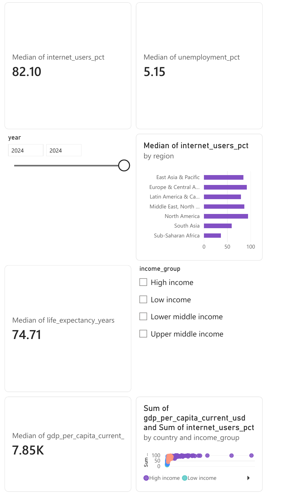

# Global Development Pulse | World Bank indicators

A Power BI portfolio project comparing economic, health, digital access, and labor indicators across country economies. The curated panel covers **217 country economies** from **2020–2024**; regional and income aggregates are excluded. The 2024 comparison view uses **165 complete cases** with all four indicators available.

## Power BI report

[Open the two-page Power BI report](https://app.powerbi.com/groups/e6426da3-9b36-4519-acf1-2434daa552ae/reports/0985372a-1bb2-4e08-8818-e99d8b4c9564/33ebee685092240a7305?experience=power-bi) (workspace access may be required). The **2024 Overview** page has four median KPI cards, a year range control set to 2024, an income-group slicer, a region-to-country drill chart, and a country scatter plot colored by income group. **Digital Access Trend** shows 2020–2024 median Internet use by income group. The report uses the Bloom theme.

[Download the two-page PDF export](global-development-powerbi-report.pdf) · [Overview preview](global-development-1.png) · [Trend preview](global-development-2.png)

## Questions

- How do income, life expectancy, internet access, and unemployment vary across regions and income groups in 2024?
- Which country economies have the largest digital access gaps in the comparable sample?
- Where do missing data limit a cross-indicator comparison?

## Data and method

| Indicator | Field | World Bank code |
| --- | --- | --- |
| GDP per capita (current US$) | `gdp_per_capita_current_usd` | [`NY.GDP.PCAP.CD`](https://data.worldbank.org/indicator/NY.GDP.PCAP.CD) |
| Life expectancy at birth (years) | `life_expectancy_years` | [`SP.DYN.LE00.IN`](https://data.worldbank.org/indicator/SP.DYN.LE00.IN) |
| Individuals using the Internet (% of population) | `internet_users_pct` | [`IT.NET.USER.ZS`](https://data.worldbank.org/indicator/IT.NET.USER.ZS) |
| Unemployment (% of total labor force, modeled ILO estimate) | `unemployment_pct` | [`SL.UEM.TOTL.ZS`](https://data.worldbank.org/indicator/SL.UEM.TOTL.ZS) |

Run `python scripts/build_dataset.py` to retrieve the indicators and country metadata from the [World Bank API](https://api.worldbank.org/v2/). The script writes [`data/world_development_2020_2024.csv`](data/world_development_2020_2024.csv) and [`analysis/summary.json`](analysis/summary.json). Source accessed 2026-11-04. The country economy universe includes territories and other economies recognized by the API; it is not a list of sovereign states.

Power BI KPI cards and charts use the non-missing economies **for each displayed indicator**; the sample size therefore varies by metric. The independent four-indicator complete-case comparison in [`reports/FINDINGS.md`](reports/FINDINGS.md) uses 165 economies. Country medians are unweighted; they are **not** population-weighted global or regional estimates. Current-dollar GDP per capita should be used for a same-year cross section, not interpreted as real growth over time. The indicators have different source methods, and comparisons are descriptive rather than causal.

One source value for Central African Republic's 2022 life expectancy is 18.818 years. The CSV preserves it in `life_expectancy_source_years`, while `life_expectancy_years` is blanked for that observation because the value is implausible in the surrounding series. It is listed in the summary for review. No other source values are imputed.

World Bank open data is generally [CC BY 4.0](https://datacatalog.worldbank.org/public-licenses); each indicator page identifies its underlying source and license. This repository transforms and republishes the cited indicator data with attribution.

## Repository

- `scripts/build_dataset.py` — repeatable API extraction, country filtering, validation, and summary
- `data/world_development_2020_2024.csv` — Power BI import file, one row per country economy and year
- `analysis/summary.json` — independent coverage and median checks
- `reports/FINDINGS.md` — findings and caveats

